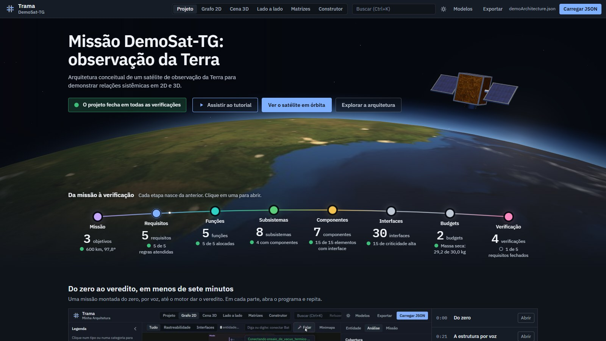
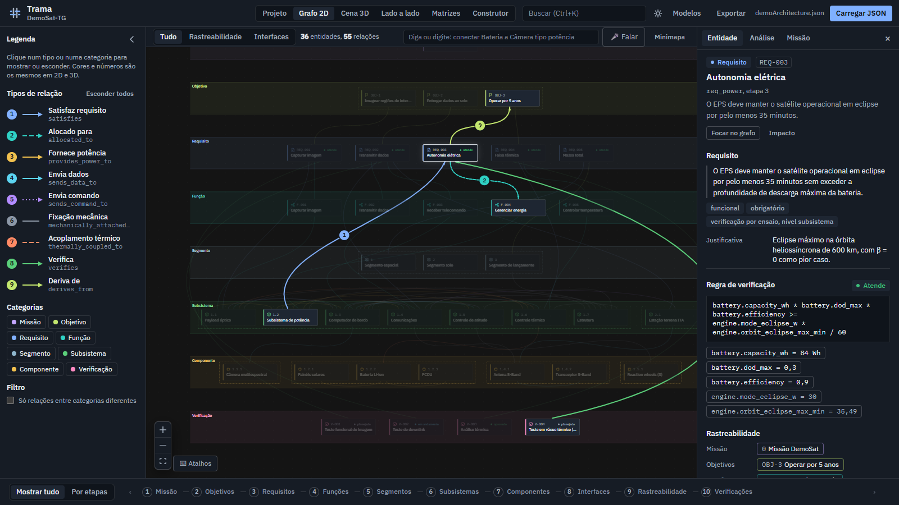
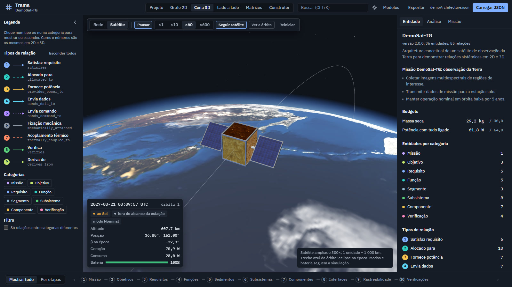
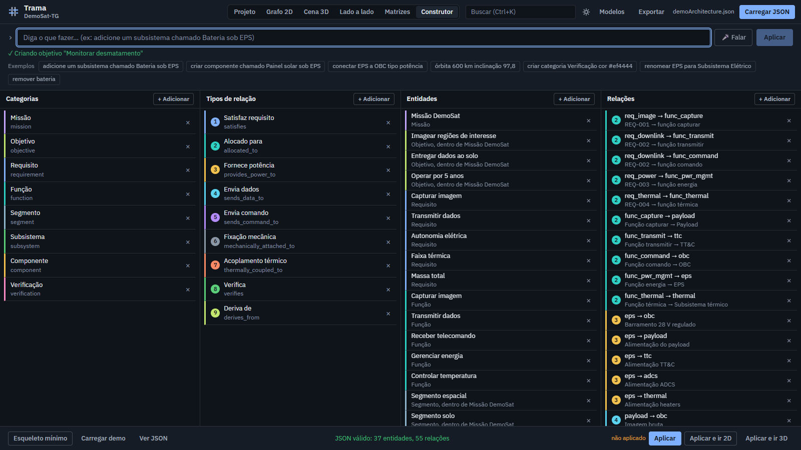

# Trama

O Trama é uma aplicação web para modelar a arquitetura de um sistema espacial como uma rede rastreável: missão, objetivos, requisitos, funções, segmentos, subsistemas, componentes, interfaces, budgets e verificação. Um único arquivo JSON descreve o satélite, e a mesma descrição alimenta o grafo 2D, a cena 3D, as matrizes de engenharia, a análise de missão e os relatórios exportados.

O projeto é o Trabalho de Graduação de Victor Henrique Stein em Engenharia Aeroespacial no Instituto Tecnológico de Aeronáutica (ITA), concluído em 2026. O foco são os estudos de fase 0/A: cada parâmetro pode ser um valor ou uma fórmula, cada requisito pode ter uma regra verificada automaticamente e a análise de missão (órbita, eclipse, passes, enlace, energia, dados, decaimento e térmico) mostra a conta, as hipóteses e a fonte de cada número.

Tudo roda no navegador. Não há back-end, conta, chave de API nem coleta de dados: o modelo fica na memória da página, e o que se quiser guardar é exportado como arquivo.

| | |
|---|---|
|  |  |
| Tela inicial: a cadeia da missão à verificação e o veredito do projeto | Grafo 2D: um requisito, sua regra paramétrica e a rastreabilidade |
|  |  |
| Cena 3D: o satélite em órbita, com eclipse, estação solo e telemetria simulada | Construtor: o modelo montado por comandos em português, digitados ou falados |

## O que o Trama faz

- **Tela Projeto.** Mostra se o projeto fecha: a contagem e a saúde de cada elo da cadeia e as verificações por trás do veredito (regras de requisito, budgets, energia, bateria, enlace, dados, vida orbital, térmico e auditoria de lacunas).
- **Grafo 2D.** Rede em camadas com códigos de PBS (0, 1.1, 1.1.2) e de requisito (REQ-001). Tem três lentes (tudo, rastreabilidade e interfaces), linha do tempo em dez etapas, modo de foco e inspetor com parâmetros, regra, rastreabilidade em vários caminhos e análise de impacto.
- **Cena 3D.** A mesma rede em três dimensões ou o satélite físico em órbita: Terra com dia e noite, trecho de eclipse, estação solo com círculo de cobertura e simulação de tempo até ×600.
- **Lado a lado.** Grafo e cena juntos; com a simulação rodando, o grafo apaga os elementos desligados no modo operacional do momento.
- **Matrizes.** N² de interfaces, VCRM com o estado de cada verificação e matriz de riscos 5×5.
- **Motor paramétrico.** Fórmulas avaliadas em ordem topológica, detecção de ciclos, budgets com margens de maturidade (5/10/20 %) e de sistema, modos operacionais e potência média por órbita.
- **Análise de missão.** Órbita, β e eclipse ao longo do ano, passes sobre a estação, enlace linha a linha, painel e bateria, dados, ΔV, decaimento (regras de 25 anos da IADC e de 5 anos da FCC) e térmico de nó único, cada cartão com "Mostrar a conta".
- **Edição viva.** Todo parâmetro declarado tem campo no inspetor. Cada edição é validada, reavaliada e pode ser desfeita (Ctrl+Z) ou refeita (Ctrl+Shift+Z); os elementos afetados pulsam no grafo em ordem de distância.
- **Varredura de projeto.** Varia altitude, inclinação, LTAN ou qualquer parâmetro e mostra, para cada valor, eclipse, contato, margem de enlace, energia, bateria, vida orbital, massa e regras atendidas.
- **Construtor e comandos de voz.** Frases como "adicione um subsistema chamado Bateria sob EPS" ou "órbita 600 km inclinação 97,8" mudam o modelo. A lista completa está em [docs/comandos.md](docs/comandos.md).
- **Busca e ações (Ctrl+K).** Encontra entidades, abre vistas e matrizes, exporta e executa comandos do Construtor.
- **Exportação.** JSON da arquitetura, relatório HTML imprimível e CSVs de requisitos e VCRM, parâmetros, budgets e interfaces N².
- **Modelos de partida.** DemoSat-TG, um satélite de observação da Terra de 30 kg, e AmbSat-3U, um CubeSat 3U. Qualquer JSON válido pode ser carregado pelo botão "Carregar JSON".

## Como executar

Há três caminhos. Os dois primeiros rodam o código-fonte e precisam do Node.js; o terceiro usa a versão já compilada e não precisa instalar nada.

### 1. Atalho de dois cliques

Baixe o repositório (botão **Code > Download ZIP**, ou `git clone`) e descompacte.

- **Windows:** dê dois cliques em `Iniciar TRAMA.bat`.
- **macOS:** dê dois cliques em `Iniciar TRAMA.command`. Se o macOS bloquear, clique com o botão direito, escolha **Abrir** e confirme; nas versões mais novas, a liberação fica em **Ajustes do Sistema > Privacidade e Segurança > Abrir Mesmo Assim**. Também dá para abrir o Terminal na pasta e rodar `sh iniciar.sh`.
- **Linux:** no terminal, dentro da pasta, rode `sh iniciar.sh`.

O atalho confere se o Node.js está instalado (e abre a página de download se não estiver), instala as dependências na primeira execução, o que leva de um a três minutos e precisa de internet, e abre o Trama no navegador. Para encerrar, feche a janela do terminal. Se o macOS responder "permissão negada" ao duplo clique, rode `chmod +x "Iniciar TRAMA.command"` uma vez, ou use `sh iniciar.sh`.

### 2. Pelo terminal

```bash
npm ci          # instala as dependências exatas do package-lock.json
npm run dev     # serve em http://localhost:4173; abra o endereço no navegador
```

Outros scripts:

| Comando | O que faz |
|---|---|
| `npm run check` | lint, os testes e o build de produção, nessa ordem |
| `npm test` | só os testes (Vitest) |
| `npm run build` | gera `dist/`, que pode ser servida por qualquer servidor de arquivos |
| `npm run preview` | serve `dist/` localmente |
| `npm run release` | gera o build e empacota a versão pronta em `release/TRAMA-<versão>.zip` |

O `vite.config.ts` usa `host: true`, então o servidor de desenvolvimento aceita conexões de outras máquinas da mesma rede. Para limitá-lo ao próprio computador, use `npm run dev -- --host localhost`, que é o que os atalhos fazem.

### 3. Versão pronta, sem instalar nada

Na página **Releases** deste repositório, baixe `TRAMA-<versão>.zip`, descompacte e siga o `LEIA-ME.txt`. No Windows basta dar dois cliques em `Abrir TRAMA.bat`, que usa o PowerShell do próprio sistema como servidor local. No macOS e no Linux, `abrir.sh` faz o mesmo com o Python 3.

Não abra o `index.html` direto do disco: páginas carregadas por `file://` não podem carregar os módulos JavaScript do app.

### Requisitos

- Node.js 20.19 ou mais novo para os caminhos 1 e 2 (as versões LTS 22 e 24 servem). No Windows, `npm ci` e `npm run check` passam com Node 20.19, 22.23 e 24.15; o `package-lock.json` traz os binários de build para Windows, macOS e Linux.
- Um navegador atual. Chrome e Edge têm suporte completo, inclusive a voz.
- Internet na primeira instalação das dependências.

### Voz e internet

Os comandos de voz usam o reconhecimento de fala do próprio navegador, sem chave de API. Funcionam no Chrome e no Edge, pedem permissão de microfone e precisam de internet, porque o navegador envia o áudio para o serviço de transcrição dele (Google no Chrome, Microsoft no Edge). A página tem de estar em `http://localhost` ou em HTTPS; um endereço `http://` de rede local não libera o microfone. No Firefox o botão de voz fica desativado. Os mesmos comandos podem ser digitados, e aí funcionam sem internet.

Afora a voz, há uma única chamada externa: a cena 3D baixa de `cdn.jsdelivr.net` a fonte dos rótulos 3D quando abre. Sem acesso a esse endereço, as duas cenas 3D (rede e satélite) ficam em branco; a tela Projeto, o grafo 2D, as matrizes, o Construtor e as análises funcionam offline. As demais fontes, as texturas da Terra e o vídeo vêm do próprio projeto.

## Um passeio de cinco minutos

1. No **Grafo 2D**, clique num requisito. O inspetor mostra o texto, a regra paramétrica com os valores que ela lê, o estado ("atende" ou "viola") e a rastreabilidade.
2. Na aba **Análise** do inspetor, veja a cobertura, a auditoria de lacunas, os budgets de massa e potência com margens e os modos operacionais.
3. Na aba **Missão**, abra "Mostrar a conta" em qualquer cartão para ver fórmula, hipóteses, fonte e as entradas ligadas aos parâmetros do modelo.
4. Ainda na aba Missão, mude a altitude para 700 km e acompanhe a onda de impacto no grafo. Depois selecione a bateria e reduza a capacidade para 20 Wh: o requisito de autonomia em eclipse passa a "viola". Ctrl+Z desfaz.
5. Na **Cena 3D**, escolha **Satélite** para ver a órbita, o eclipse, a estação solo e a telemetria simulada.
6. Em **Matrizes**, confira a N², a VCRM e os riscos. Em **Exportar**, gere o relatório HTML.

## Estrutura do projeto

```
src/
  domain/       modelo, validação, motor de fórmulas e análises, sem dependência de React
  components/   vistas: Projeto, grafo 2D, cena 3D, matrizes, painéis e Construtor
  state/        store único (zustand)
  data/         modelos de partida (DemoSat-TG e AmbSat-3U)
public/         texturas da Terra e vídeo da tela inicial
docs/           documentação, exemplo mínimo de modelo e imagens deste README
scripts/        scripts de reprodução das análises e empacotamento da versão pronta
```

A arquitetura do código está descrita em [docs/arquitetura.md](docs/arquitetura.md).

## Testes

`npm run check` roda o ESLint, os 122 testes do Vitest e o build (`tsc` e Vite). Os testes da biblioteca de missão comparam os resultados com valores publicados (SMAD e Vallado), por exemplo período de 94,6 min a 500 km, FSPL de 159,3 dB a 2,2 GHz e 1 000 km e Hohmann de 500 para 800 km com 0,161 km/s, e com a biblioteca `satellite.js` (SGP4 e conversões de referencial), usada só nos testes.

A pasta `scripts/` tem quatro scripts que recalculam números do trabalho com o motor real, sobre o modelo DemoSat-TG. Eles rodam com `npx vite-node scripts/<nome>.ts`:

| Script | Saída |
|---|---|
| `verificacao_referencias.ts` | grandezas da análise de missão comparadas com os valores de referência |
| `tarefas_pdr.ts` | respostas às oito perguntas de PDR usadas no estudo de tarefas |
| `janela_altitude.ts` | vida orbital e GSD em função da altitude (tabela de dados) |
| `linha_operacao.ts` | modos, potência e estado de carga nas três primeiras horas (tabela de dados) |

## Documentação

| Documento | Conteúdo |
|---|---|
| [docs/arquitetura.md](docs/arquitetura.md) | organização do código, fluxo de dados, motor, biblioteca de missão e regras visuais |
| [docs/modelo-json.md](docs/modelo-json.md) | como escrever um modelo: blocos, fórmulas, regras e valores `engine.*` |
| [docs/exemplo-minimo.json](docs/exemplo-minimo.json) | modelo mínimo que carrega no app e passa nas duas regras |
| [docs/comandos.md](docs/comandos.md) | comandos do Construtor, da barra do grafo e da voz |
| [docs/benchmark_mercado.md](docs/benchmark_mercado.md) | comparação com Cameo, Capella, Valispace, DOORS, Jama, COMET e outras ferramentas |
| [docs/revisao_engenharia_sistemas.md](docs/revisao_engenharia_sistemas.md) | revisão técnica do modelo de demonstração e da lógica de análise |

## Limitações

- As análises são de fase 0/A: órbita circular, Kepler com J₂ secular, sombra cilíndrica e térmico de nó único. Servem para fechar o balanço conceitual e não substituem STK, GMAT ou um modelo térmico de vários nós.
- A cena física é ilustrativa: o satélite aparece ampliado 300 vezes, com a geometria derivada da massa, da área de painel e do radiador.
- O uso é individual. Não há edição colaborativa nem histórico de baselines, e o desfazer vive só na memória da página; o JSON exportado é a unidade de versionamento.

## Créditos

- Texturas da Terra: NASA, Visible Earth. Diurna: Blue Marble Next Generation, dezembro de 2004, 5400×2700 (<https://visibleearth.nasa.gov/images/73909>); luzes noturnas (Black Marble) e nuvens, 2048×1024. Imagens da NASA são, em geral, de domínio público e podem ser usadas com crédito; política de uso em <https://www.nasa.gov/nasa-brand-center/images-and-media/>.
- Fontes IBM Plex Sans e IBM Plex Mono (SIL Open Font License), empacotadas pelo Fontsource.
- Bibliotecas: React, React Flow, react-three-fiber e drei, three.js, zustand, Zod e astronomy-engine (posição do Sol).

O vídeo da tela inicial (`public/video/tutorial.mp4`, 6 min 46 s) é o tutorial "Do zero ao veredito": uma missão de teste montada do zero no próprio app, por voz e no Construtor, até o motor dar o veredito. As imagens são gravações da tela do TRAMA.

## Licença

Este repositório não tem arquivo de licença. Sem uma licença declarada, os direitos sobre o código ficam com o autor: é possível ler, clonar e executar o projeto, mas reutilizar ou redistribuir o código pede autorização. Os materiais de terceiros listados em Créditos seguem as licenças indicadas.
